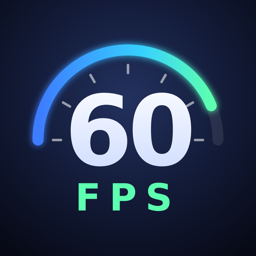
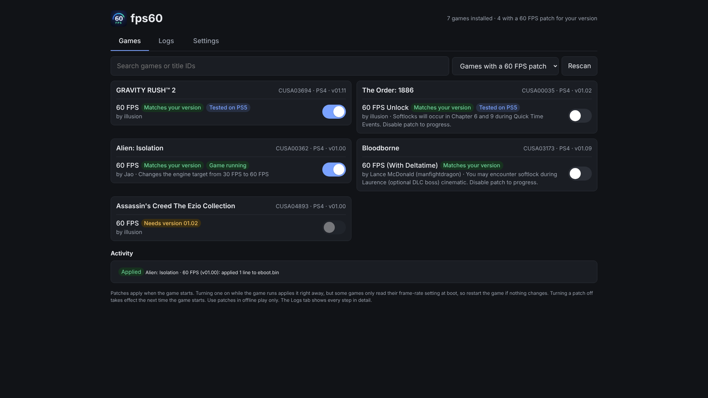
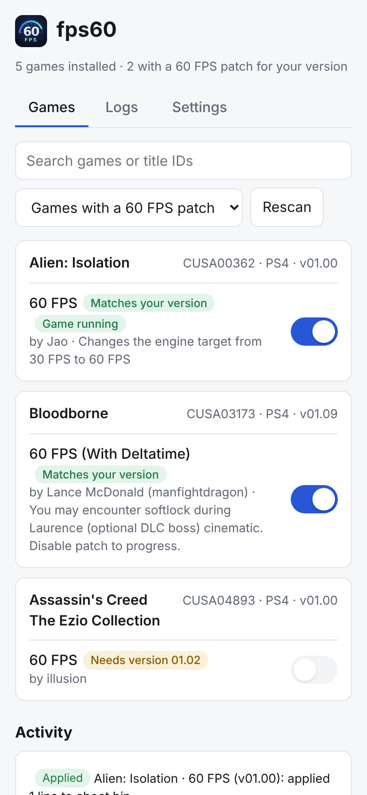
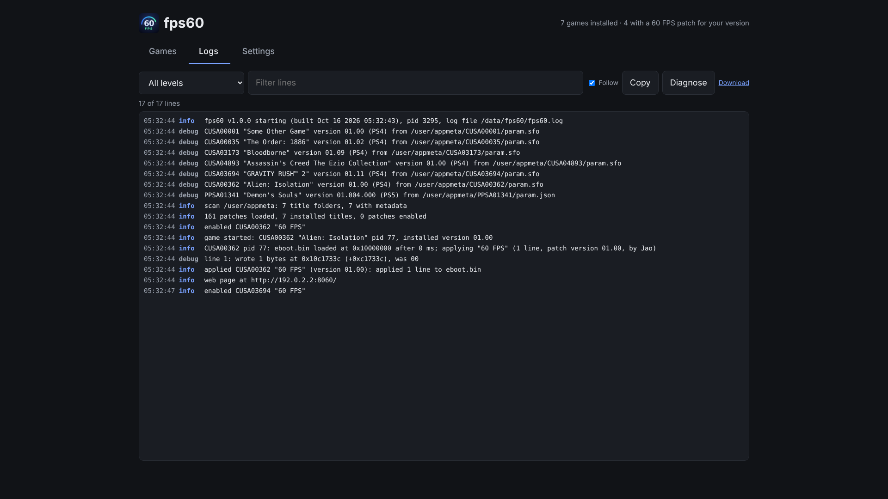
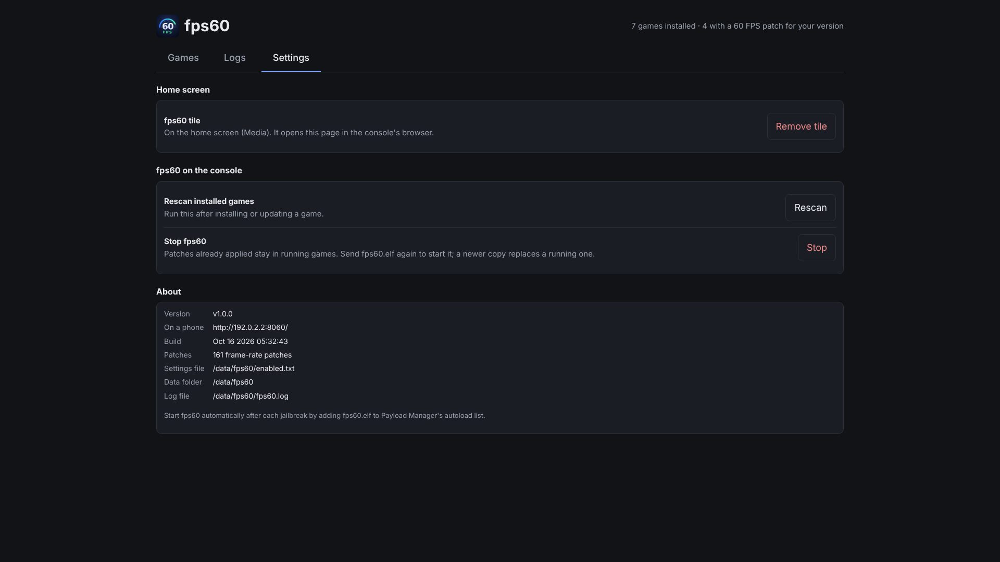
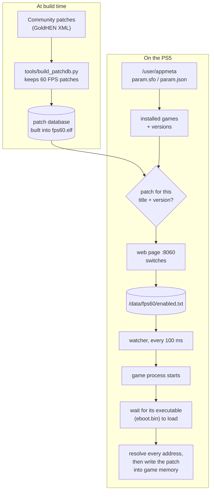

<p align="center"></p>

<h1 align="center">fps60</h1>

<p align="center">
  Unlock 60 FPS in PS4 and PS5 games on a jailbroken PS5, with one switch per game.<br>
  <a href="https://github.com/eladharels/ps5-60fps/releases/latest"></a>
  <a href="https://github.com/eladharels/ps5-60fps/actions/workflows/build.yml"></a>
</p>



fps60 is a payload for a jailbroken PS5. It looks at the games you have
installed, finds the ones that have a known 60 FPS patch for your exact game
version, and lets you switch those patches on from a page on the console's
own browser (or your phone). When you start a patched game, fps60 writes the
patch into the game's memory as it loads. Your game files are never changed.

> The screenshots in this README come from a test run with sample games on a
> PC, so the page looks exactly as it does on the console.

## Contents

- [What you need](#what-you-need)
- [Quick start](#quick-start)
- [Tested games](#tested-games)
- [Using fps60](#using-fps60)
- [How it works](#how-it-works)
- [Files on the console](#files-on-the-console)
- [Limits and safety](#limits-and-safety)
- [Troubleshooting](#troubleshooting)
- [Versions and releases](#versions-and-releases)
- [Building from source](#building-from-source)
- [Credits](#credits)

## What you need

- A PS5 that is jailbroken and running an **ELF loader** on port `9021`.
  Firmware up to 13.60 works with the Relapse exploit, which provides one.
- A way to send a payload: Payload Manager, the exploit's payload menu, or a
  computer on the same network (`socat` or `make test`).
- Optional: [Payload Manager](https://github.com/itsPLK/ps5-payload-manager),
  to start fps60 automatically after each jailbreak.

## Quick start

1. **Download `fps60.elf`** from the
   [latest release](https://github.com/eladharels/ps5-60fps/releases/latest)
   (or the zip, which also has this README and the changelog).
2. **Send it to the console** after jailbreaking:
   ```bash
   socat -t 99999999 - TCP:<ps5-ip>:9021 < fps60.elf
   ```
   or pick it in Payload Manager. The console shows
   *"fps60 v1.0.0 running: http://&lt;ps5-ip&gt;:8060"*.
3. **Open fps60.** On the home screen, go to **Media** and open the **fps60**
   tile. It opens the page in the console's browser. On a phone or computer
   on the same network, open `http://<ps5-ip>:8060` instead.
4. **Switch on a patch** for a game marked *Matches your version*.
5. **Start the game.** A notification says *"&lt;game&gt;: 60 FPS enabled"*.

fps60 keeps running until the console restarts or goes into rest mode. Your
switches are saved, so after a reboot you only need to send `fps60.elf` again.
To skip even that, add `fps60.elf` to Payload Manager's autoload list.

## Tested games

These patches have been confirmed working on a real PS5. They show a
**Tested on PS5** label on the Games tab, and the **Tested on PS5** filter
lists only them.

| Game | Patch | Game version | Notes |
| --- | --- | --- | --- |
| Gravity Rush 2 | 60 FPS | 01.11 | |
| The Order: 1886 | 60 FPS Unlock | 01.02 | The patch author notes softlocks in chapters 6 and 9 during quick-time events: switch the patch off to get past them. |

The other patches come from the community and should work the same way, but
haven't been tried with fps60 yet. If you test one, open an issue with the
game, its version and the result, so it can be added here.

## Using fps60

### Games



Every installed game with a frame-rate patch is listed with its title ID,
whether it's a PS4 or PS5 game, and the installed version. Each patch has a
switch and a label:

- **Matches your version:** the patch is made for the version you have
  installed. You can switch it on.
- **Tested on PS5:** confirmed working on a real console (see
  [Tested games](#tested-games)).
- **Needs version X:** the patch exists, but for another game version.
  Update (or downgrade) the game to use it.
- **Not supported by fps60:** the patch uses a feature fps60 doesn't
  implement.
- **Game running:** the game is running now and the patch is on.

The author and the patch notes are shown under each patch. Read them: some
patches have side effects, such as a cutscene you need to switch the patch
off for.

- **Search** filters by name or title ID.
- **Tested on PS5** shows only tested patches; **All installed games** shows
  games without a patch too.
- **Rescan** reads the installed games again (after installing or updating
  a game).
- **Activity** lists what was applied, and why a patch failed.

Switching a patch **on** while the game is running applies it right away.
Some games only read their frame-rate setting at startup, so restart the game
if nothing changes. Switching a patch **off** takes effect the next time the
game starts.

The same page works on a phone or computer on your network, at
`http://<ps5-ip>:8060`.

<br clear="right">

### Logs



Every step fps60 takes is logged:

- which metadata files it read for each game
- when a game starts and exits
- where each patch line was written, and which bytes were there before
- every error

You can filter by level or text, **Copy** or **Download** the log, and
**Diagnose** writes every running process and its loaded modules to the log.
That shows how a game looks to fps60 if it isn't being detected. While you're
on another tab, a red number on **Logs** counts new errors.

### Settings



- **Home screen tile:** remove or reinstall the **fps60** tile. If you remove
  it, fps60 doesn't put it back on its next start.
- **Rescan installed games.**
- **Stop fps60.** Patches already applied stay in running games.
- **About:** the address to open on a phone, the build, and where fps60 keeps
  its files.

### Updating and stopping

- **Update:** send the new `fps60.elf`. It asks the running copy to stop and
  takes its place, and you get *"fps60 restarted"*.
- **Stop:** use **Stop** in Settings, or kill `fps60.elf` in Payload Manager's
  process list (fps60 names its process `fps60.elf` so it shows up there).

## How it works



**There's no system-wide 30 FPS setting.** Every game limits its own frame
rate, so every unlock is a hand-made patch for one version of one game. fps60
uses the community patches from
[illusion0001/PS4-PS5-Game-Patch](https://github.com/illusion0001/PS4-PS5-Game-Patch).

1. **Patch database.** At build time `tools/build_patchdb.py` keeps only the
   frame-rate unlocks (about 160) and converts them into a compact format.
   All value encoding happens there: little-endian integers, floats, UTF-8 and
   UTF-16 strings, byte patterns with wildcards. The result is built into
   `fps60.elf`.
2. **Installed games.** fps60 reads each game's metadata, `param.sfo` for PS4
   games and `param.json` for PS5 games, from `/user/appmeta`,
   `/system_data/priv/appmeta` and a few fallback folders. That gives the
   title ID, name and installed version.
3. **Finding the running game.** A watcher checks the running processes
   10 times a second. It identifies games by their title ID and, as a fallback,
   asks the system which game is in the foreground. That second method is
   what makes PS4 games running on the PS5 work.
4. **Applying a patch.** When a game with an enabled patch starts, fps60 waits
   for its executable to load and finds its base address.
   - It computes every address first: fixed addresses relative to the game's
     image base, or a search of the game's code for a byte pattern.
   - Only when all of them are found does it write, so a patch is applied
     completely or not at all.
   - Bundles with several executables, such as the Ezio Collection, get each
     part as its executable loads.
   - A running game is patched once. Switching a patch off and on doesn't
     write it again.
5. **The page and the tile.** fps60 serves its page on port `8060`. The home
   screen tile is a small media app whose link opens `http://127.0.0.1:8060/`
   in the console's browser.

## Files on the console

| Path | What it is |
| --- | --- |
| `/data/fps60/enabled.txt` | The patches you switched on (one `TITLEID<TAB>patch name` per line) |
| `/data/fps60/fps60.log` | The log of the current run (`fps60.log.1` is the previous run) |
| `/data/fps60/patches.db` | Optional: a newer patch database to use instead of the built-in one |
| `/data/fps60/no-tile` | Present if you removed the home screen tile |
| `/user/app/FPSU00060` | The home screen tile |

To update the patch list without rebuilding fps60, copy a newer
`build/patches.db` to `/data/fps60/patches.db` and send fps60 again.

## Limits and safety

- **Coverage.** About 160 patches, almost all for PS4 games running on the
  PS5. Very few native PS5 games have one.
- **Exact versions.** A patch only works on the game version it was made for.
- **Side effects.** Some games behave oddly at 60 FPS (physics or timers tied
  to the frame rate, or stutter when the GPU can't keep up). Read the patch
  notes.
- **Offline only.** Changing a game's memory during online play can get an
  account flagged.
- **Your network.** The page and the ELF loader are reachable by anything on
  your home network. Don't forward their ports to the internet.

## Troubleshooting

| Problem | What to do |
| --- | --- |
| No games are listed | Open **Logs**: each scanned folder and metadata file is listed. Send the log to whoever helps you. |
| Patch shows **Failed** | The Activity line and the log say why: another game version, a pattern that wasn't found, or a write that failed. |
| Nothing happens when the game starts | Check that the log shows *game started*. If not, press **Diagnose** and look for the game's process. |
| The tile isn't on the home screen | In **Settings**, press **Install tile**, then filter the log for `tile`. |
| *"port 8060 is busy"* | Another program uses port 8060, or the running fps60 didn't stop. Restart the console. |
| The tile opens an error page | fps60 isn't running. Send `fps60.elf` again (or add it to Payload Manager's autoload). |

## Versions and releases

Every version is published on the
[Releases page](https://github.com/eladharels/ps5-60fps/releases) with:

- `fps60.elf`, ready to send to the console
- `fps60-vX.Y.Z.zip`, which holds the same ELF plus this README and the
  changelog

What changed in each version is in [CHANGELOG.md](CHANGELOG.md) and in each
release's notes. The running version is shown in the start notification and
under Settings > About.

Version numbers follow [semantic versioning](https://semver.org):

- **X:** goes up for changes that break your setup.
- **Y:** goes up for new features.
- **Z:** goes up for fixes.

Publishing a new version (for maintainers):

1. In a pull request, put the new number in `VERSION` and add a
   `## [X.Y.Z] - date` section at the top of `CHANGELOG.md`.
2. Merge it into `main`.
3. The *release* workflow then:
   - runs the tests
   - builds with the pinned SDK (v0.44)
   - creates the tag `vX.Y.Z`
   - publishes the release with the changelog section as its notes

   It skips versions that already have a release. You can also start it by
   hand from Actions > release > Run workflow.

## Building from source

```bash
sudo apt-get install make clang-18 lld-18 llvm-18 wget unzip zip python3 git socat
wget https://github.com/ps5-payload-dev/sdk/releases/download/v0.44/ps5-payload-sdk.zip
sudo unzip -d /opt ps5-payload-sdk.zip
export PS5_PAYLOAD_SDK=/opt/ps5-payload-sdk LLVM_CONFIG=/usr/bin/llvm-config-18

make            # fps60.elf
make check      # host tests: no SDK or console needed
make dist       # build/fps60-vX.Y.Z.zip
make test PS5_HOST=<ps5-ip>   # send fps60.elf and stream its log
```

The first `make` clones the patch repository into `build/patch-repo`. Set
`PATCH_REPO=<path>` to use an existing checkout.

### Tests

`make check` runs on a normal Linux PC with AddressSanitizer and UBSan:

- the converter's encoding of every patch value type
- a parse of the real patch database
- metadata parsing, including damaged files
- pattern scans across chunk boundaries
- the watcher against a fake game process: apply on start, re-apply after a
  restart, bundles, and no second write after a switch is turned off and on
- the web routes, settings file and log

### CI

GitHub Actions builds `fps60.elf`, runs the tests and uploads the `fps60`
artifact on every push and pull request. An optional deploy job sends the
build to your console. It needs a self-hosted runner on your home network,
since GitHub's cloud runners can't reach the console. Configure it with these
repository variables:

| Variable | Default | Meaning |
| --- | --- | --- |
| `PS5_HOST` | unset: deploy skipped | Console IP |
| `PS5_PORT` | `9021` | ELF loader port |
| `PS5_RUNNER` | `ubuntu-24.04` | Runner label for the deploy job |

The repository is public, so before adding a self-hosted runner, set Settings >
Actions > General > *Require approval for all external contributors*.

### Layout

| Folder | Contents |
| --- | --- |
| `fps60/` | Game scanning (`titles.c`), patch database (`patchdb.c`), patcher (`patcher.c`), watcher and state (`app.c`), console-specific code (`platform_ps5.c`), the page (`ui.html`) and the icon (`assets/`) |
| `common/` | Shared payload framework: web server, log, startup/replace/stop (`service.c`), notifications and home screen tile (`sys_ps5.c`), Logs and Settings tabs (`ui/`) |
| `tools/` | `build_patchdb.py` (patch converter) and `embed.py` (builds the page, patches and icon into the ELF) |
| `.github/workflows/` | `build.yml` (tests and builds every push), `release.yml` (publishes a release for a version tag) |
| `tests/` | Host tests |

## Credits

- Patches: the authors credited on each patch, collected in
  [illusion0001/PS4-PS5-Game-Patch](https://github.com/illusion0001/PS4-PS5-Game-Patch)
  (GoldHEN patch format).
- [ps5-payload-dev/sdk](https://github.com/ps5-payload-dev/sdk), the PS5
  payload SDK.
- The home screen tile uses the approach introduced by John Törnblom's ftpsrv
  and used by Payload Manager.

Sister project: [NetDis](https://github.com/eladharels/ps5-netdis) shows
every network port in use on the console.
